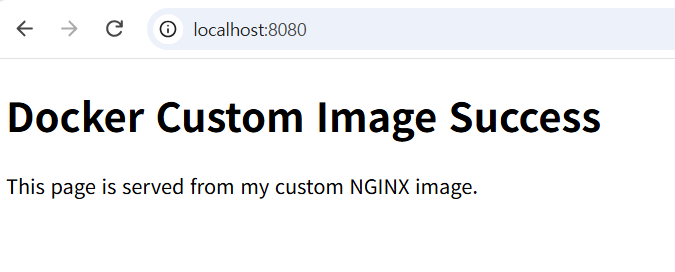
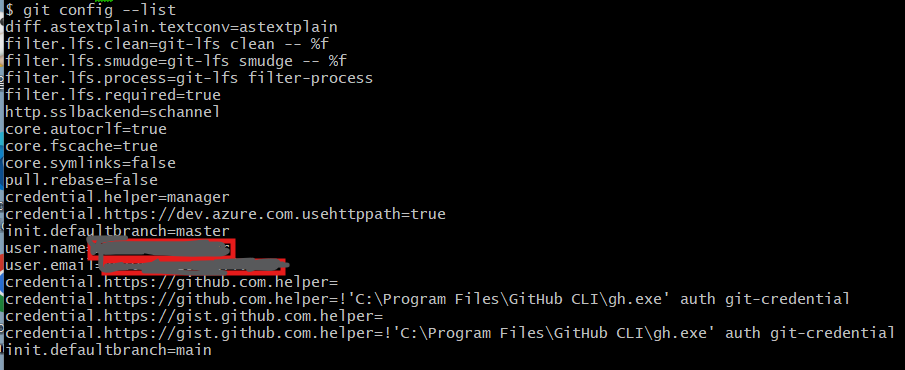

# 내 컴퓨터에 개발자용 '작업실' 꾸미기

## 1. 프로젝트 개요
이 프로젝트는 개발 워크스테이션을 직접 구성해보며,
터미널, 권한, Docker, Git/GitHub의 기본 흐름을 익히는 것을 목표로 한다.

### 미션 목표 요약
- 터미널로 디렉토리/파일 조작 및 권한 변경 실습
- Docker 설치 및 기본 명령 점검
- hello-world / ubuntu 컨테이너 실행 및 확인
- Dockerfile 기반 커스텀 이미지 제작
- 포트 매핑, 바인드 마운트, 볼륨 영속성 검증
- Git 설정 및 GitHub 연동 확인

---

## 2. 실행 환경
- oS: Windows 11 
- 터미널: [예: Git Bash / Windows Terminal / WSL Ubuntu / PowerShell]
- Docker: Docker Desktop x.x.x 
- Git: git version x.x.x

## 3. 수행 체크리스트

- [x] 터미널 기본 조작 및 폴더 구성
- [x] 권한 변경 실습
- [x] Docker 설치/점검
- [x] hello-world 실행
- [x] ubuntu 컨테이너 실행 및 내부 명령 수행
- [x] Dockerfile 작성 및 커스텀 이미지 빌드
- [x] 포트 매핑 접속 확인
- [x] 바인드 마운트 반영 확인
- [x] 볼륨 영속성 확인
- [x] Git 설정 및 GitHub 연동 확인


## 4. 터미널 조작 로그

### 4-1. 현재 위치 확인

---
$ pwd
/c/Users/kwi04
---

### 4-2. 목록 확인(숨김 파일 포함)

---
$ ls -la
total 12508
drwxr-xr-x 1 kwi041172 197121       0 Nov  6 18:16  ./
drwxr-xr-x 1 kwi041172 197121       0 Sep 21 10:56  ../
-rw-r--r-- 1 kwi041172 197121     354 Nov  6 18:16  .bash_history
drwxr-xr-x 1 kwi041172 197121       0 Sep 21 15:34  .cache/
drwxr-xr-x 1 kwi041172 197121       0 Nov  9 18:15  .codex/
drwxr-xr-x 1 kwi041172 197121       0 Nov  3 14:53  .config/
drwxr-xr-x 1 kwi041172 197121       0 Oct 24 13:38  .copilot/
drwxr-xr-x 1 kwi041172 197121       0 Nov  6 15:30  .docker/
-rw-r--r-- 1 kwi041172 197121     326 Nov  6 17:36  .gitconfig
drwxr-xr-x 1 kwi041172 197121       0 Oct 23 23:25  .ipython/
-rw-r--r-- 1 kwi041172 197121      26 Nov  6 17:36  .lesshst
drwxr-xr-x 1 kwi041172 197121       0 Oct  2 19:44  .ssh/
drwxr-xr-x 1 kwi041172 197121       0 Oct 24 00:38  .vscode/
drwxr-xr-x 1 kwi041172 197121       0 Sep 23 10:06  .vscode-shared/
drwxr-xr-x 1 kwi041172 197121       0 Sep 21 10:35  AppData/
lrwxrwxrwx 1 kwi041172 197121      30 Sep 21 10:35 'Application Data' -> /c/Users/kwi04/AppData/Roaming/
drwxr-xr-x 1 kwi041172 197121       0 Sep 21 10:38  Contacts/
lrwxrwxrwx 1 kwi041172 197121      58 Sep 21 10:35  Cookies -> /c/Users/kwi04/AppData/Local/Microsoft/Windows/INetCookies/
drwxr-xr-x 1 kwi041172 197121       0 Oct  3 01:36  Documents/
drwxr-xr-x 1 kwi041172 197121       0 Nov  9 17:46  Downloads/
drwxr-xr-x 1 kwi041172 197121       0 Sep 21 10:38  Favorites/
drwxr-xr-x 1 kwi041172 197121       0 Oct 20 16:51  IntelGraphicsProfiles/
drwxr-xr-x 1 kwi041172 197121       0 Sep 21 10:38  Links/
lrwxrwxrwx 1 kwi041172 197121      28 Sep 21 10:35 'Local Settings' -> /c/Users/kwi04/AppData/Local/
drwxr-xr-x 1 kwi041172 197121       0 Sep 21 10:38  Music/
lrwxrwxrwx 1 kwi041172 197121      24 Sep 21 10:35 'My Documents' -> /c/Users/kwi04/Documents/
-rw-r--r-- 1 kwi041172 197121 7602176 Nov  8 21:38  NTUSER.DAT
-rw-r--r-- 1 kwi041172 197121   73728 Oct 20 16:48  NTUSER.DAT{645b5e33-b55b-11f1-a351-98af65fb5603}.TM.blf
-rw-r--r-- 1 kwi041172 197121    4096 Nov  8 21:38  NTUSER.DAT{645b5e33-b55b-11f1-a351-98af65fb5603}.TM.blf.cnpf
-rw-r--r-- 1 kwi041172 197121  561152 Oct 20 16:48  NTUSER.DAT{645b5e33-b55b-11f1-a351-98af65fb5603}.TMContainer00000000000000000001.regtrans-ms
-rw-r--r-- 1 kwi041172 197121    4096 Nov  8 21:38  NTUSER.DAT{645b5e33-b55b-11f1-a351-98af65fb5603}.TMContainer00000000000000000001.regtrans-ms.cnpf
-rw-r--r-- 1 kwi041172 197121  561152 Oct 20 16:48  NTUSER.DAT{645b5e33-b55b-11f1-a351-98af65fb5603}.TMContainer00000000000000000002.regtrans-ms
-rw-r--r-- 1 kwi041172 197121    4096 Nov  8 21:38  NTUSER.DAT{645b5e33-b55b-11f1-a351-98af65fb5603}.TMContainer00000000000000000002.regtrans-ms.cnpf
lrwxrwxrwx 1 kwi041172 197121      66 Sep 21 10:35  NetHood -> '/c/Users/kwi04/AppData/Roaming/Microsoft/Windows/Network Shortcuts'/
drwxr-xr-x 1 kwi041172 197121       0 Nov  9 11:11  OneDrive/
lrwxrwxrwx 1 kwi041172 197121      66 Sep 21 10:35  PrintHood -> '/c/Users/kwi04/AppData/Roaming/Microsoft/Windows/Printer Shortcuts'/
lrwxrwxrwx 1 kwi041172 197121      55 Sep 21 10:35  Recent -> /c/Users/kwi04/AppData/Roaming/Microsoft/Windows/Recent/
drwxr-xr-x 1 kwi041172 197121       0 Sep 21 10:38 'Saved Games'/
drwxr-xr-x 1 kwi041172 197121       0 Sep 21 10:56  Searches/
lrwxrwxrwx 1 kwi041172 197121      55 Sep 21 10:35  SendTo -> /c/Users/kwi04/AppData/Roaming/Microsoft/Windows/SendTo/
lrwxrwxrwx 1 kwi041172 197121      58 Sep 21 10:35  Templates -> /c/Users/kwi04/AppData/Roaming/Microsoft/Windows/Templates/
drwxr-xr-x 1 kwi041172 197121       0 Sep 21 12:07  Videos/
-rw-r--r-- 1 kwi041172 197121 1966080 Sep 21 10:35  ntuser.dat.LOG1
-rw-r--r-- 1 kwi041172 197121 1949696 Sep 21 10:35  ntuser.dat.LOG2
-rw-r--r-- 1 kwi041172 197121      20 Sep 21 10:35  ntuser.ini
drwxr-xr-x 1 kwi041172 197121       0 Oct 20 17:03  seoul/
lrwxrwxrwx 1 kwi041172 197121      59 Sep 21 10:35 '시작 메뉴' -> '/c/Users/kwi04/AppData/Roaming/Microsoft/Windows/Start Menu'/
---

### 4-3. 생성

---
kwi041172@▒▒ MINGW64 ~
$ mkdir note

kwi041172@▒▒ MINGW64 ~
$ touch note/test.txt
---

### 4-4. 이동

---
kwi041172@▒▒ MINGW64 ~
$ cd note

kwi041172@▒▒ MINGW64 ~/note
---

### 4-5. 복사

---
kwi041172@▒▒ MINGW64 ~/note
$ cp test.txt test_copy.txt

kwi041172@▒▒ MINGW64 ~/note
$ ls -la
total 16
drwxr-xr-x 1 kwi041172 197121 0 Nov  9 18:42 ./
drwxr-xr-x 1 kwi041172 197121 0 Nov  9 18:28 ../
-rw-r--r-- 1 kwi041172 197121 0 Nov  9 18:28 test.txt
-rw-r--r-- 1 kwi041172 197121 0 Nov  9 18:42 test_copy.txt
---

### 4-6. 이동/이름변경

---
kwi041172@▒▒ MINGW64 ~/note
$ mv test_copy.txt done.txt

kwi041172@▒▒ MINGW64 ~/note
$ ls -la
total 16
drwxr-xr-x 1 kwi041172 197121 0 Nov  9 18:47 ./
drwxr-xr-x 1 kwi041172 197121 0 Nov  9 18:28 ../
-rw-r--r-- 1 kwi041172 197121 0 Nov  9 18:42 done.txt
-rw-r--r-- 1 kwi041172 197121 0 Nov  9 18:28 test.txt
---

### 4-7. 삭제

---
kwi041172@▒▒ MINGW64 ~/note
$ rm done.txt

kwi041172@▒▒ MINGW64 ~/note
$ ls -la
total 16
drwxr-xr-x 1 kwi041172 197121 0 Nov  9 18:49 ./
drwxr-xr-x 1 kwi041172 197121 0 Nov  9 18:28 ../
-rw-r--r-- 1 kwi041172 197121 0 Nov  9 18:28 test.txt
---

## 5. 권한 실습 및 증거 기록

### 5-1. 실습 대상
- 파일: `text.txt`
- 디렉토리: `sample_dir`

### 5-2. 실습 준비

아래 명령으로 파일과 디렉토리를 생성했다.

```
touch text.txt
mkdir sample_dir
---

### 5-3. 변경 전 권한 확인

---
drwxr-xr-x    2 root     root          1024 Nov 10 03:37 sample_dir
-rw-r--r--    1 root     root             0 Nov 10 03:37 text.txt
---

### 5-4 변경 후 권한 확인

파일은 소유자만 읽기/쓰기 가능하도록 변경하고,
디렉토리는 소유자만 접근 가능하도록 변경했다.

---
chmod 600 text.txt
chmod 700 sample_dir
---

---
drwx------    2 root     root          1024 Nov 10 03:37 sample_dir
-rw-------    1 root     root             0 Nov 10 03:37 text.txt
---

## 6. Docker 설치 및 기본 점검

### 6-1. Docker 버전 확인

---
PS C:\Windows\System32> docker --version
Docker version 29.9.2, build a82e528
---

### 6-2. Docker 데몬 동작 여부 확인

---
PS C:\Windows\System32> docker info
Client:
 Version:    29.9.2
 Context:    desktop-linux
 Debug Mode: false
 Plugins:
  agent: Docker AI Agent Runner (Docker Inc.)
    Version:  v1.152.0
    Path:     C:\Program Files\Docker\cli-plugins\docker-agent.exe
  ai: Docker AI Agent - Ask Gordon (Docker Inc.)
    Version:  v1.33.0
    Path:     C:\Program Files\Docker\cli-plugins\docker-ai.exe
  buildx: Docker Buildx (Docker Inc.)
    Version:  v0.38.1
    Path:     C:\Program Files\Docker\cli-plugins\docker-buildx.exe
  compose: Docker Compose (Docker Inc.)
    Version:  v5.6.1
    Path:     C:\Program Files\Docker\cli-plugins\docker-compose.exe
  debug: Get a shell into any image or container (Docker Inc.)
    Version:  0.49.0
    Path:     C:\Program Files\Docker\cli-plugins\docker-debug.exe
  desktop: Docker Desktop commands (Docker Inc.)
    Version:  4.98.0
    Path:     C:\Program Files\Docker\cli-plugins\docker-desktop.exe
  dhi: CLI for managing Docker Hardened Images (Docker Inc.)
    Version:  v0.0.9
    Path:     C:\Program Files\Docker\cli-plugins\docker-dhi.exe
  extension: Manages Docker extensions (Docker Inc.)
    Version:  v0.2.32
    Path:     C:\Program Files\Docker\cli-plugins\docker-extension.exe
  init: Creates Docker-related starter files for your project (Docker Inc.)
    Version:  v1.4.1
    Path:     C:\Program Files\Docker\cli-plugins\docker-init.exe
  mcp: Docker MCP Plugin (Docker Inc.)
    Version:  v0.44.2
    Path:     C:\Program Files\Docker\cli-plugins\docker-mcp.exe
  model: Docker Model Runner (Docker Inc.)
    Version:  v1.2.9
    Path:     C:\Program Files\Docker\cli-plugins\docker-model.exe
  offload: Docker Offload (Docker Inc.)
    Version:  v0.7.35
    Path:     C:\Program Files\Docker\cli-plugins\docker-offload.exe
  pass: Docker Pass Secrets Manager Plugin (beta) (Docker Inc.)
    Version:  v0.3.2
    Path:     C:\Program Files\Docker\cli-plugins\docker-pass.exe
  sandbox: "docker sandbox" is deprecated, use Docker Sandboxes instead (Docker Inc.)
    Version:  v0.13.0
    Path:     C:\Program Files\Docker\cli-plugins\docker-sandbox.exe
  scout: Docker Scout (Docker Inc.)
    Version:  v1.27.0
    Path:     C:\Program Files\Docker\cli-plugins\docker-scout.exe

Server:
failed to connect to the docker API at npipe:////./pipe/dockerDesktopLinuxEngine; check if the path is correct and if the daemon is running: open //./pipe/dockerDesktopLinuxEngine: The system cannot find the file specified.
---

## 7. Docker 기본 운영 명령 수행

### 7-1. 이미지 다운로드 / 목록 확인

---
PS C:\Windows\System32> docker images
                                                                                                   i Info →   U  In Use
IMAGE                ID             DISK USAGE   CONTENT SIZE   EXTRA
hello-world:latest   c567b231f656       25.9kB         9.49kB    U
my-web:latest        d4c2d825094e        241MB         63.9MB    U
myweb:latest         9a18bbeeafbc        241MB         63.9MB    U
nginx:latest         165ddde8751e        243MB         66.8MB    U
ubuntu:latest        6a06111c3b0a        163MB         45.9MB
---

### 7-2. 컨테이너 실행 

---
PS C:\Windows\System32> docker run hello-world

Hello from Docker!
This message shows that your installation appears to be working correctly.

To generate this message, Docker took the following steps:
 1. The Docker client contacted the Docker daemon.
 2. The Docker daemon pulled the "hello-world" image from the Docker Hub.
    (amd64)
 3. The Docker daemon created a new container from that image which runs the
    executable that produces the output you are currently reading.
 4. The Docker daemon streamed that output to the Docker client, which sent it
    to your terminal.

To try something more ambitious, you can run an Ubuntu container with:
 $ docker run -it ubuntu bash

Share images, automate workflows, and more with a free Docker ID:
 https://hub.docker.com/

For more examples and ideas, visit:
 https://docs.docker.com/get-started/
---

### 7-3. 실행 중인 컨테이너 목록 확인

---
PS C:\Windows\System32> docker ps
CONTAINER ID   IMAGE     COMMAND   CREATED   STATUS    PORTS     NAMES
PS C:\Windows\System32>
---

### 7-4. 전체 컨테이너 목록 확인

---
PS C:\Windows\System32> docker ps -a
CONTAINER ID   IMAGE         COMMAND                   CREATED             STATUS                     PORTS                  NAMES
02be3027a785   hello-world   "/hello"                  About an hour ago   Exited (0) 5 minutes ago                          adoring_swartz
d30f788664b0   hello-world   "/hello"                  About an hour ago   Exited (0) 6 minutes ago                          stoic_burnell
2e795e51819f   hello-world   "/hello"                  About an hour ago   Exited (0) 7 minutes ago                          condescending_moser
b9c0ceaa69d4   nginx         "/docker-entrypoint.…"   3 days ago          Exited (255) 2 hours ago   0.0.0.0:8082->80/tcp   my-web-live
9a63d98133f5   my-web        "/docker-entrypoint.…"   4 days ago          Exited (255) 2 hours ago   0.0.0.0:8081->80/tcp   my
4f0686d73578   my-web        "/docker-entrypoint.…"   4 days ago          Exited (255) 2 hours ago   0.0.0.0:8080->80/tcp   my-web
036f180acaba   hello-world   "/hello"                  4 days ago          Exited (0) 4 days ago                             crazy_proskuriakova
5a224640f908   hello-world   "/hello"                  5 days ago          Exited (0) 5 days ago                             laughing_bardeen
PS C:\Windows\System32>
---

### 7-5. 컨테이너 로그 확인

---
PS C:\Windows\System32> docker logs my-web
/docker-entrypoint.sh: /docker-entrypoint.d/ is not empty, will attempt to perform configuration
/docker-entrypoint.sh: Looking for shell scripts in /docker-entrypoint.d/
/docker-entrypoint.sh: Launching /docker-entrypoint.d/10-listen-on-ipv6-by-default.sh
10-listen-on-ipv6-by-default.sh: info: Getting the checksum of /etc/nginx/conf.d/default.conf
10-listen-on-ipv6-by-default.sh: info: Enabled listen on IPv6 in /etc/nginx/conf.d/default.conf
/docker-entrypoint.sh: Sourcing /docker-entrypoint.d/15-local-resolvers.envsh
/docker-entrypoint.sh: Launching /docker-entrypoint.d/20-envsubst-on-templates.sh
/docker-entrypoint.sh: Launching /docker-entrypoint.d/30-tune-worker-processes.sh
/docker-entrypoint.sh: Configuration complete; ready for start up
2026/11/06 06:30:47 [notice] 1#1: using the "epoll" event method
2026/11/06 06:30:47 [notice] 1#1: nginx/1.31.8
2026/11/06 06:30:47 [notice] 1#1: built by gcc 14.2.0 (Debian 14.2.0-19)
2026/11/06 06:30:47 [notice] 1#1: OS: Linux 6.18.54.1-microsoft-standard-WSL2
2026/11/06 06:30:47 [notice] 1#1: getrlimit(RLIMIT_NOFILE): 1048576:1048576
2026/11/06 06:30:47 [notice] 1#1: start worker processes
2026/11/06 06:30:47 [notice] 1#1: start worker process 29
2026/11/06 06:30:47 [notice] 1#1: start worker process 30
2026/11/06 06:30:47 [notice] 1#1: start worker process 31
2026/11/06 06:30:47 [notice] 1#1: start worker process 32
2026/11/06 06:30:47 [notice] 1#1: start worker process 33
2026/11/06 06:30:47 [notice] 1#1: start worker process 34
2026/11/06 06:30:47 [notice] 1#1: start worker process 35
2026/11/06 06:30:47 [notice] 1#1: start worker process 36
172.17.0.1 - - [06/Nov/2026:06:36:35 +0000] "GET / HTTP/1.1" 200 251 "-" "Mozilla/5.0 (Windows NT 10.0; Win64; x64) AppleWebKit/537.36 (KHTML, like Gecko) Chrome/156.0.0.0 Safari/537.36" "-"
2026/11/06 06:36:35 [error] 29#29: *1 open() "/usr/share/nginx/html/favicon.ico" failed (2: No such file or directory), client: 172.17.0.1, server: localhost, request: "GET /favicon.ico HTTP/1.1", host: "localhost:8080", referrer: "http://localhost:8080/"
172.17.0.1 - - [06/Nov/2026:06:36:35 +0000] "GET /favicon.ico HTTP/1.1" 404 555 "http://localhost:8080/" "Mozilla/5.0 (Windows NT 10.0; Win64; x64) AppleWebKit/537.36 (KHTML, like Gecko) Chrome/156.0.0.0 Safari/537.36" "-"
---

### 7-6. 컨테이너 리소스 확인

---
PS C:\Windows\System32> docker stats my-web
CONTAINER ID   NAME      CPU %     MEM USAGE / LIMIT   MEM %     NET I/O   BLOCK I/O   PIDS
4f0686d73578   my-web    0.00%     0B / 0B             0.00%     0B / 0B   0B / 0B     0
---

## 8.컨테이너 실행 실습

### 8-1. hello-world 실행 성공 기록

---
7-2 참조
---

### 8-2. ubuntu 컨테이너 실행 및 내부 진입

---
[Docker 컨테이너 실행 화면](./images/docker-container-run.png)

---

### 8-3. attach와 exec 차이 관찰

1) attach 사용

---
PS C:\Windows\System32> docker attach test
root@c70deedec79d:/# echo "hello attach"
hello attach
root@c70deedec79d:/# exit
exit
PS C:\Windows\System32> docker ps -a
CONTAINER ID   IMAGE         COMMAND                   CREATED          STATUS                      PORTS                  NAMES
c70deedec79d   ubuntu        "bash"                    49 minutes ago   Exited (0) 4 minutes ago                           test
---

**관찰 결과**
- `attach`는 컨테이너의 **메인 프로세스(bash)** 에 직접 연결된다.
- 메인 프로세스를 종료하면 컨테이너도 종료된다.
- 따라서 `attach`는 “이미 실행 중인 메인 프로세스에 직접 붙는 방식”이라고 이해했다.

2) exec 사용

---
PS C:\Windows\System32> docker start test
test
PS C:\Windows\System32> docker exec -it test bash
root@c70deedec79d:/# ls
bin  boot  dev  etc  home  lib  lib64  media  mnt  opt  proc  root  run  sbin  srv  sys  tmp  usr  var
root@c70deedec79d:/# echo "exec test"
exec test
root@c70deedec79d:/# exit
exit

What's next:
    Try Docker Debug for seamless, persistent debugging tools in any container or image → docker debug test
    Learn more at https://docs.docker.com/go/debug-cli/
PS C:\Windows\System32> docker ps
CONTAINER ID   IMAGE     COMMAND   CREATED             STATUS         PORTS     NAMES
c70deedec79d   ubuntu    "bash"    About an hour ago   Up 2 minutes             test
---

**관찰 결과**
- `exec`는 실행 중인 컨테이너 안에 **새로운 명령/쉘을 추가로 실행**하는 방식이다.
- `exec`를 종료해도 컨테이너 자체는 계속 실행된다.
- 즉, `exec`는 컨테이너의 메인 프로세스를 대체하지 않는다.

## 9. 기존 Dockerfile 기반 커스템 이미지 제작

### 9-1. 실습 환경
- 운영체제: Windows
- 터미널: PowerShell
- 도구: Docker Desktop, VSCode

### 9-2. 선택한 기존 베이스 이미지

이번 실습에서는 웹 서버 베이스 이미지인 **NGINX**를 선택했다.

---

- 베이스 이미지: `nginx:latest`
- 선택 이유:
  - 웹 서버 기능이 기본으로 포함되어 있어 실행이 쉽다.
  - 정적 HTML 파일만 교체하면 커스터마이징이 가능하다.
  - 빌드와 실행 결과를 눈으로 바로 확인할 수 있어 실습에 적합하다.

---

### 9-3. 내가 적용한 커스텀 포인트

| 커스텀 항목 | 목적 |
|---|---|
| `index.html` 교체 | 기본 NGINX 페이지 대신 내가 만든 페이지를 보여주기 위해 |
| `COPY` 명령 사용 | 커스텀 HTML 파일을 이미지 내부 웹 루트에 넣기 위해 |
| 포트 매핑(`8080:80`) | Windows 브라우저에서 접속 결과를 쉽게 확인하기 위해 |

---

### 9-4. Dockerfile

---
FROM nginx:latest
COPY index.html /usr/share/nginx/html/index.html
```

### 9-5. index.html

---
<!DOCTYPE html>
<html lang="ko">
<head>
  <meta charset="UTF-8">
  <title>Custom NGINX Page</title>
</head>
<body>
  <h1>Docker Custom Image Success</h1>
  <p>This page is served from my custom NGINX image.</p>
</body>
</html>
```

### 9-6. 이미지 빌드

```
docker build -t my-nginx .
```

빌드 결과:

```
PS C:\Users\kwi04\OneDrive\Desktop\e1-1_mission> docker build -t my-nginx .
[+] Building 1.2s (7/7) FINISHED                                                                docker:desktop-linux
 => [internal] load build definition from Dockerfile                                                            0.1s
 => => transferring dockerfile: 104B                                                                            0.0s
 => [internal] load metadata for docker.io/library/nginx:latest                                                 0.0s
 => [internal] load .dockerignore                                                                               0.0s
 => => transferring context: 2B                                                                                 0.0s
 => [internal] load build context                                                                               0.1s
 => => transferring context: 275B                                                                               0.0s
 => CACHED [1/2] FROM docker.io/library/nginx:latest@sha256:165ddde8751e75a1c907d24ef10d9f6deb08b57e0fe56caf67  0.1s
 => => resolve docker.io/library/nginx:latest@sha256:165ddde8751e75a1c907d24ef10d9f6deb08b57e0fe56caf67512486a  0.1s
 => [2/2] COPY index.html /usr/share/nginx/html/index.html                                                      0.1s
 => exporting to image                                                                                          0.4s
 => => exporting layers                                                                                         0.1s
 => => exporting manifest sha256:064ce88c5771c1968c3218ce4184bc4ac7ee3e873ebe0baa6bc65d1e3b146739               0.0s
 => => exporting config sha256:cd84a1d60c2cddb1a42dabd9d73408869c1671c551a90970766b34d19e65ca94                 0.0s
 => => exporting attestation manifest sha256:43ba43e6ec79e00633ef6e638e3f70005b90cf52b6996751b4d89ae2e1f0f5e6   0.0s
 => => exporting manifest list sha256:70c1870a269a379769998b529466cfe140cdbbb1d6ec4d7534b4d1ef0ba8a5fe          0.0s
 => => naming to docker.io/library/my-nginx:latest                                                              0.0s
 => => unpacking to docker.io/library/my-nginx:latest                                                           0.1s

View build details: docker-desktop://dashboard/build/desktop-linux/desktop-linux/f4fvz1rbz8995krrlyhf1z99v
---

### 9-7. 컨테이너 실행

빌드한 커스텀 이미지를 사용하여 컨테이너를 실행했다.

---
docker run -d -p 8080:80 --name my-nginx my-nginx
```

실행 결과:

---
PS C:\Users\kwi04\OneDrive\Desktop\e1-1_mission> docker run -d -p 8080:80 --name my-nginx my-nginx
04a90ec0730afcee4037d54cab5cc33667e7476290292fa26fcef12c42ebe468
---

### 9-8. 실행 상태 확인

---
docker ps
---

확인 결과:

---
PS C:\Users\kwi04\OneDrive\Desktop\e1-1_mission> docker ps
CONTAINER ID   IMAGE      COMMAND                   CREATED         STATUS         PORTS        NAMES
04a90ec0730a   my-nginx   "/docker-entrypoint.…"   8 minutes ago   Up 8 minutes   0.0.0.0:8080->80/tcp, [::]:8080->80/tcp   my-nginx
---

## 10. 포트 매핑 및  접속 증거

브라우저에서 아래 주소로 접속하여 내가 만든 페이지가 표시되는지 확인했다.

---
http://localhost:8080
---

확인 결과:

---
[nginx 실행 화면](./images/nginx_container_result.png)

---

## 11. 바인드 마운트 반영 및 Docker 볼륨 영속성 검증

### 11-1. 바인드 마운트: 호스트 파일 변경 반영 확인

바인드 마운트는 Windows 호스트의 폴더를 컨테이너의 폴더에 연결하는 방식이다. 호스트에서 파일을 수정하고 컨테이너가 제공하는 웹 페이지에서 변경 내용을 확인한다.

실행 명령

---
docker run -d -p 8082:80 --name my-nginx-live -v ${PWD}:/usr/share/nginx/html nginx
```

실행 전

---
[바인드마운트 실행 전 화면](./images/bind-before.png)

---

실행 후

---
[nginx 실행 화면](./images/bind-after.png)

---

### 11-2. Docker 볼륨

Docker 볼륨은 컨테이너와 별도로 관리되는 저장 공간이다. 볼륨을 삭제하지 않으면 컨테이너를 삭제한 뒤에도 데이터가 남는지 확인할 수 있다. 

볼륨 생성 및 확인

---
docker volume create mydata
docker volume ls
---

---
PS C:\Users\kwi04\OneDrive\Desktop\e1-1_mission> docker volume create mydata
mydata
PS C:\Users\kwi04\OneDrive\Desktop\e1-1_mission> docker volume ls
DRIVER    VOLUME NAME
local     mydata
---

### 11-3. 첫 번째 컨테이너에 연결해 데이터 저장

---
docker run -it --name vol-test -v mydata:/data ubuntu
---

볼륨 안에 파일을 만들고 내용을 읽는다.

---
echo "hello volume" > /data/memo.txt
---

### 11-4. 첫 번째 컨테이너 삭제 후 같은 볼륨에 재연결

첫 번째 컨테이너를 삭제한다.

---
docker rm vol-test 
docker volume ls
---

같은 볼륨을 새 컨테이너에 연결하고 새 컨테이너에서 이전 파일을 읽는다.

---
docker run -it --rm -v mydata:/data ubuntu cat /data/memo.txt
---


### 11-5. 볼륨 영속성 증거 기록

---
PS C:\Users\kwi04\OneDrive\Desktop\e1-1_mission> docker volume create mydata
mydata
PS C:\Users\kwi04\OneDrive\Desktop\e1-1_mission> docker volume ls
DRIVER    VOLUME NAME
local     mydata
PS C:\Users\kwi04\OneDrive\Desktop\e1-1_mission> docker run -it --name vol-test -v mydata:/data ubuntu
root@33a6c661f23d:/# echo "hello volume" > /data/memo.txt
root@33a6c661f23d:/# exit
exit
PS C:\Users\kwi04\OneDrive\Desktop\e1-1_mission> docker rm vol-test 
vol-test
PS C:\Users\kwi04\OneDrive\Desktop\e1-1_mission> docker volume ls
DRIVER    VOLUME NAME
local     mydata
PS C:\Users\kwi04\OneDrive\Desktop\e1-1_mission> docker run -it --rm -v mydata:/data ubuntu cat /data/memo.txt
hello volume
---

## 12. Git 설정 및 GitHub/VS Code 연동

### 12-1. 사전 확인

Git과 VS Code가 설치되어 있는지 확인합니다.

---
PS C:\Users\kwi04\OneDrive\Desktop\e1-1_mission> git --version                           
git version 2.55.0.windows.5
PS C:\Users\kwi04\OneDrive\Desktop\e1-1_mission> code --version                                               
1.146.0
69047191fc427f2f92828279aae1d90d8eeda7ab
x64
---

### 12-2. Git 사용자 정보와 기본 브랜치 설정

---
git config --global user.name "kwi******-co***"
git config --global user.email "kwi******@gmail.com"
git config --global init.defaultBranch main
---

git --list 결과

---
[git list 실행 화면](./images/git-list.png)

---

### 12-3. GitHub 저장소와 로컬 프로젝트 연결

GitHub에서 저장소 준비

---
https://github.com/kwi******-co***/e1-1_mission.git
---

GitHub에서 연동

---
[git list 실행 화면](./images/git-list.png)

---

## 13. 트러블슈팅

### 13-1. 트러블슈팅 1 : Windows Git Bash에서 `chmod` 후 권한 표시가 바뀌지 않음

**문제**

Windows Git Bash에서 `chmod` 후 권한 표시가 바뀌지 않음

**원인 가설**

- Git Bash가 현재 Windows 파일 시스템에서 `chmod`로 요청한 권한을 그대로 적용하지 못했다.
- `ls -la`가 실제 Windows ACL을 Linux와 같은 권한 비트로 표현하지 못했다.

**확인**

- Git Bash에서 명령과 표시 결과 재확인
- PowerShell에서 해당 폴더로 이동해 확인

**해결/대안**
- Windows 권한을 관리해야 하는 경우 PowerShell에서 해당 폴더로 이동해 해결한다.
- 과제에서 `600`, `700` 같은 Linux 권한 비트가 실제로 적용되고 바뀌는 모습을 보여줘야 한다면, WSL의 Ubuntu 등  
  Linux 파일 시스템 안에서 실습하는 방법이 가장 명확하다.

### 13-2. 트러블슈팅 2 : Docker 명령이 엔진에 연결되지 않음 (Windows)

**문제**

PowerShell에서 Ubuntu 이미지를 내려받으려고 `docker pull ubuntu`를 실행했지만 Docker 엔진에 연결되지 않아 실패했다.

**원인 가설**

첫 실행 시점에 Docker Desktop이 아직 시작되지 않았거나, Linux 컨테이너 엔진이 준비되기 전이었을 가능성이 있다.

**확인**

- Docker Desktop과 엔진 상태 확인
- 이미지 내려받기 다시 시도

**해결/대안**

1. Windows 시작 메뉴에서 **Docker Desktop**을 실행한다.
2. Docker Desktop이 완전히 시작될 때까지 기다린다.
3. PowerShell을 열어 `docker info`를 실행하고 서버 정보가 나오는지 확인한다.
4. 다시 이미지 다운를 실행한다.
 