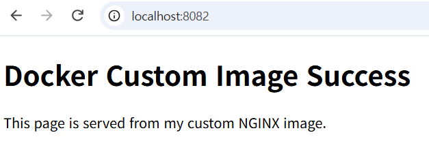

# 내 컴퓨터에 개발자용 작업실 꾸미기

터미널과 Linux 파일 권한, Docker, Git/GitHub의 기본 흐름을 직접 실습하고, NGINX 기반 웹 페이지를 빌드·실행한 과정을 정리한 프로젝트입니다.

## 목차

- [프로젝트 개요](#프로젝트-개요)
- [실행 환경](#실행-환경)
- [프로젝트 파일](#프로젝트-파일)
- [실습 결과](#실습-결과)
  - [터미널과 파일 권한](#1-터미널과-파일-권한)
  - [Docker 기본 명령과 컨테이너](#2-docker-기본-명령과-컨테이너)
  - [커스텀 NGINX 이미지](#3-커스텀-nginx-이미지)
  - [포트 매핑과 바인드 마운트](#4-포트-매핑과-바인드-마운트)
  - [Docker 볼륨의 데이터 영속성](#5-docker-볼륨의-데이터-영속성)
  - [Git 및 GitHub 연동](#6-git-및-github-연동)
- [문제 해결 기록](#문제-해결-기록)
- [마무리](#마무리)

## 프로젝트 개요

이번 실습에서는 터미널에서 파일과 디렉터리를 다루고, Linux 권한을 변경하는 방법을 확인했습니다. 이어 Docker 컨테이너를 실행하고, Dockerfile로 커스텀 NGINX 이미지를 빌드했습니다. 포트 매핑, 바인드 마운트, 볼륨을 차례로 적용해 컨테이너와 호스트 간 연결 및 데이터 보존 방식도 확인했습니다. 마지막으로 Git 저장소를 만들고 GitHub에 연동했습니다.

### 실습 체크리스트

- [x] 터미널에서 디렉터리와 파일 생성·이동·복사·삭제
- [x] Linux 파일 및 디렉터리 권한 변경
- [x] Docker 설치 및 이미지·컨테이너 명령 확인
- [x] `hello-world` 및 Ubuntu 컨테이너 실행
- [x] Dockerfile로 커스텀 NGINX 이미지 빌드
- [x] 포트 매핑을 통한 웹 페이지 접속
- [x] 바인드 마운트로 호스트 파일 변경 반영
- [x] Docker 볼륨의 데이터 영속성 확인
- [x] Git 설정 및 GitHub 저장소 연동

## 실행 환경

| 항목 | 버전 또는 환경 |
|---|---|
| 운영체제 | Windows 11 |
| 터미널 | PowerShell, Git Bash |
| Docker Desktop | 4.98.0 |
| Docker Engine/CLI | 29.9.2 |
| Git | 2.55.0 |
| Visual Studio Code | 1.146.0 |

## 프로젝트 파일

```text
.
├── Dockerfile
├── README.md
├── index.html
└── images/
    ├── bind-after.png
    ├── bind-before.png
    ├── docker-build-result.png.png
    ├── docker-container-run.png.png
    ├── git-list.png
    └── nginx_container_result.png
```

## 실습 결과

### 1. 터미널과 파일 권한

Git Bash에서 현재 위치와 파일 목록을 확인하고, `note` 디렉터리와 파일을 만들어 복사·이름 변경·삭제를 실습했습니다. 예를 들어 파일을 복사하고 이름을 바꾸는 명령은 다음과 같습니다.

```bash
cp test.txt test_copy.txt
mv test_copy.txt done.txt
rm done.txt
```

Linux 환경에서 `text.txt` 파일은 소유자만 읽고 쓸 수 있도록 `600`, `sample_dir` 디렉터리는 소유자만 접근할 수 있도록 `700`으로 변경했습니다.

```bash
touch text.txt
mkdir sample_dir
chmod 600 text.txt
chmod 700 sample_dir
ls -l text.txt
ls -ld sample_dir
```

확인 결과:

```text
-rw-------  text.txt
drwx------  sample_dir
```

### 2. Docker 기본 명령과 컨테이너

Docker 버전을 확인하고 `hello-world` 이미지를 실행해 Docker 컨테이너가 정상적으로 동작하는지 확인했습니다. Ubuntu 컨테이너에서는 셸에 진입해 기본 명령을 실행했습니다.

```powershell
docker --version
docker images
docker run hello-world
docker ps
docker ps -a
docker run -it --name test ubuntu bash
```

`attach`와 `exec`의 차이도 확인했습니다.

- `docker attach test`는 컨테이너의 주 프로세스에 연결합니다. 주 프로세스를 종료하면 컨테이너도 종료될 수 있습니다.
- `docker exec -it test bash`는 실행 중인 컨테이너 안에서 별도의 셸을 시작합니다. 해당 셸을 종료해도 컨테이너의 주 프로세스는 계속 실행됩니다.

Ubuntu 컨테이너 실행 화면:


### 3. 커스텀 NGINX 이미지

기본 NGINX 페이지 대신 프로젝트의 `index.html`을 제공하도록 Dockerfile을 작성했습니다. `nginx:latest`를 베이스 이미지로 사용하고, HTML 파일을 NGINX 웹 루트로 복사합니다.

```dockerfile
FROM nginx:latest
COPY index.html /usr/share/nginx/html/index.html
```

이미지 빌드 및 컨테이너 실행:

```powershell
docker build -t my-nginx .
docker run -d -p 8080:80 --name my-nginx my-nginx
docker ps
```

브라우저에서 [http://localhost:8080](http://localhost:8080)에 접속해 커스텀 페이지가 표시되는 것을 확인했습니다.

빌드 결과:


웹 페이지 실행 결과:


### 4. 포트 매핑과 바인드 마운트

포트 매핑 `8080:80`은 호스트의 8080 포트를 컨테이너의 80 포트에 연결합니다. 바인드 마운트 실습에서는 프로젝트 디렉터리를 NGINX 웹 루트에 연결해 호스트의 파일 변경이 웹 페이지에 반영되는지 확인했습니다.

PowerShell에서 실행한 명령:

```powershell
docker run -d -p 8082:80 --name my-nginx-live `
  --mount "type=bind,source=$($PWD.Path),target=/usr/share/nginx/html" `
  nginx
```

호스트 디렉터리를 컨테이너의 웹 루트에 연결한 뒤 페이지를 새로 고쳐 변경 사항을 확인했습니다.

실행 전:



실행 후:


### 5. Docker 볼륨의 데이터 영속성

Docker 볼륨 `mydata`를 생성하고 Ubuntu 컨테이너의 `/data`에 연결했습니다. 파일을 저장한 컨테이너를 제거한 뒤, 같은 볼륨을 새 컨테이너에 연결해 파일이 남아 있는지 확인했습니다.

```powershell
docker volume create mydata
docker run -it --name vol-test -v mydata:/data ubuntu
```

컨테이너 안에서 파일을 생성한 다음 `exit`로 빠져나와 컨테이너를 삭제했습니다.

```bash
echo "hello volume" > /data/memo.txt
exit
```

같은 볼륨을 다시 연결해 파일 내용을 확인했습니다.

```powershell
docker rm vol-test
docker volume ls
docker run --rm -v mydata:/data ubuntu cat /data/memo.txt
```

출력 결과:

```text
hello volume
```

컨테이너를 삭제해도 볼륨을 삭제하지 않으면 볼륨 안의 데이터가 유지되는 것을 확인했습니다.

### 6. Git 및 GitHub 연동

Git 사용자 정보와 기본 브랜치를 설정하고, 프로젝트 파일을 커밋한 뒤 GitHub 원격 저장소에 푸시했습니다.

```powershell
git config --global user.name "<이름>"
git config --global user.email "<이메일>"
git config --global init.defaultBranch main

git init
git add .
git commit -m "Add project files"
git remote add origin <GitHub 저장소 URL>
git push -u origin main
```

Git 설정 확인 화면:


## 문제 해결 기록

### Windows Git Bash에서 권한 변경 결과가 기대와 다르게 보임

Windows 파일 시스템에서는 Git Bash가 Linux의 권한 비트를 완전히 동일하게 표현하거나 적용하지 못할 수 있습니다. Linux 권한 변경을 명확히 확인해야 할 때는 WSL의 Linux 파일 시스템 등 Linux 환경에서 실습하는 것이 적합합니다.

### Docker CLI가 Docker 엔진에 연결되지 않음

초기 `docker info` 실행 시 클라이언트 정보만 표시되고 Docker 서버에 연결되지 않았습니다. Docker Desktop의 엔진이 아직 시작되지 않은 상태로 확인하여 Docker Desktop이 완전히 실행된 뒤 다시 점검했습니다. 이후 이미지와 컨테이너 실행 실습을 진행했습니다.

```powershell
docker info
```

Docker 명령이 엔진에 연결되지 않으면 Docker Desktop의 실행 상태를 확인하고, 엔진 준비가 끝난 후 `docker info`를 다시 실행합니다.

## 마무리

이번 실습을 통해 터미널 기본 명령과 Linux 권한, Docker 이미지·컨테이너의 기본 흐름을 익혔습니다. 특히 포트 매핑으로 컨테이너의 웹 서비스를 호스트 브라우저에서 확인하고, 바인드 마운트와 볼륨을 비교해 호스트 파일 연결 및 컨테이너 간 데이터 보존 차이를 확인했습니다. 마지막으로 Git을 이용해 작업 내용을 버전 관리하고 GitHub 저장소에 연동했습니다.
