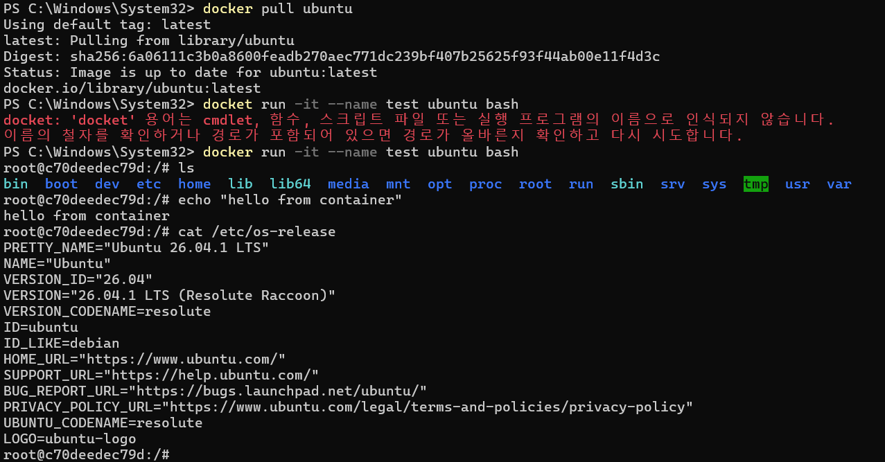
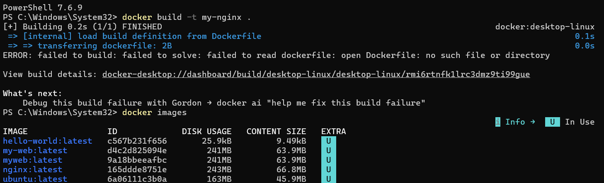
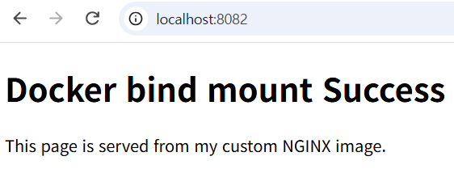

# 내 컴퓨터에 개발자용 작업실 꾸미기

터미널과 Linux 파일 권한, Docker, Git/GitHub의 기본 흐름을 직접 실습하고, NGINX 기반 웹 페이지를 빌드·실행한 과정을 정리한 프로젝트입니다.

## 목차

- [프로젝트 개요](#프로젝트-개요)
- [실행 환경](#실행-환경)
- [프로젝트 파일](#프로젝트-파일)
- [실습 결과](#실습-결과)
  - [터미널과 파일 권한](#1-터미널과-파일-권한)
  - [Docker 기본 명령과 컨테이너](#2-docker-기본-명령과-컨테이너)
  - [커스텀 NGINX 이미지](#3-커스텀-nginx-이미지)
  - [포트 매핑과 바인드 마운트](#4-포트-매핑과-바인드-마운트)
  - [Docker 볼륨의 데이터 영속성](#5-docker-볼륨의-데이터-영속성)
  - [Git 및 GitHub 연동](#6-git-및-github-연동)
- [문제 해결 기록](#문제-해결-기록)
- [마무리](#마무리)

## 프로젝트 개요

이번 실습에서는 터미널에서 파일과 디렉터리를 다루고, Linux 권한을 변경하는 방법을 확인했습니다. 이어 Docker 컨테이너를 실행하고, Dockerfile로 커스텀 NGINX 이미지를 빌드했습니다. 포트 매핑, 바인드 마운트, 볼륨을 차례로 적용해 컨테이너와 호스트 간 연결 및 데이터 보존 방식도 확인했습니다. 마지막으로 Git 저장소를 만들고 GitHub에 연동했습니다.

### 실습 체크리스트

- [x] 터미널에서 디렉터리와 파일 생성·이동·복사·삭제
- [x] Linux 파일 및 디렉터리 권한 변경
- [x] Docker 설치 및 이미지·컨테이너 명령 확인
- [x] `hello-world` 및 Ubuntu 컨테이너 실행
- [x] Dockerfile로 커스텀 NGINX 이미지 빌드
- [x] 포트 매핑을 통한 웹 페이지 접속
- [x] 바인드 마운트로 호스트 파일 변경 반영
- [x] Docker 볼륨의 데이터 영속성 확인
- [x] Git 설정 및 GitHub 저장소 연동

## 실행 환경

| 항목 | 버전 또는 환경 |
|---|---|
| 운영체제 | Windows 11 |
| 터미널 | PowerShell, Git Bash, WSL |
| Docker Desktop | 4.98.0 |
| Docker Engine/CLI | 29.9.2 |
| Git | 2.55.0 |
| Visual Studio Code | 1.146.0 |

## 프로젝트 파일

```text
.
├── Dockerfile                         # NGINX 이미지 빌드 설정
├── README.md                          # 실습 절차와 결과 기록
├── index.html                         # NGINX가 제공하는 커스텀 웹 페이지
└── images/                            # 실습 화면 캡처
    ├── bind-after.png                 # 바인드 마운트 적용 후
    ├── bind-before.png                # 바인드 마운트 적용 전
    ├── docker-build-result.png.png    # 이미지 빌드 결과
    ├── docker-container-run.png.png   # 컨테이너 실행 화면
    ├── git-list.png                   # Git 설정 확인 화면
    └── nginx_container_result.png     # 커스텀 NGINX 페이지
```

## 실습 결과

### 1. 터미널과 파일 권한

Git Bash에서 현재 위치와 파일 목록을 확인하고, 디렉터리와 파일을 만들어 복사·이름 변경·삭제를 실습했습니다. 명령은 다음과 같습니다.

```bash
pwd
ls -la
touch test.txt
mkdir test_dir
cp test.txt test_copy.txt
mv test_copy.txt done.txt
rm done.txt
```

출력 결과

---
localhost:~# pwd
/root
localhost:~# touch test.txt
localhost:~# mkdir test_dir
localhost:~# ls -la
total 6
drwx------    5 root     root          1024 Nov 17 14:58 .
drwxr-xr-x   20 root     root          1024 Nov 17 14:55 ..
-rw-------    1 root     root           309 Nov 17 14:58 .ash_history
drwxr-xr-x    3 root     root          1024 Nov  4 10:20 .docker
drwx------    2 root     root          1024 Nov 10 03:37 sample_dir
-rw-r--r--    1 root     root             0 Nov 17 14:57 test.txt
drwxr-xr-x    2 root     root          1024 Nov 17 14:58 test_dir
-rw-------    1 root     root             0 Nov 17 14:56 text.txt
localhost:~# cp test.txt test_copy.txt
localhost:~# mv test_copy.txt done.txt
localhost:~# rm done.txt
localhost:~# ls -la
total 6
drwx------    5 root     root          1024 Nov 17 14:59 .
drwxr-xr-x   20 root     root          1024 Nov 17 14:55 ..
-rw-------    1 root     root           380 Nov 17 15:00 .ash_history
drwxr-xr-x    3 root     root          1024 Nov  4 10:20 .docker
drwx------    2 root     root          1024 Nov 10 03:37 sample_dir
-rw-r--r--    1 root     root             0 Nov 17 14:57 test.txt
drwxr-xr-x    2 root     root          1024 Nov 17 14:58 test_dir
-rw-------    1 root     root             0 Nov 17 14:56 text.txt
---

Linux 환경에서 `test.txt` 파일은 소유자만 읽고 쓸 수 있도록 `600`, `test_dir` 디렉터리는 소유자만 접근할 수 있도록 `700`으로 변경했습니다.

```bash
touch test.txt
mkdir test_dir
chmod 600 test.txt
chmod 700 test_dir
ls -l 
```

확인 결과:

**변경 전**

---
root@903269743ec4:/# touch test.txt
root@903269743ec4:/# mkdir test_dir
root@903269743ec4:/# ls -l
-rw-r--r--   1 root root    0 Nov 17 15:08 test.txt
drwxr-xr-x   2 root root 4096 Nov 17 15:08 test_dir
---

**변경 후**

```text
-rw-------   1 root root    0 Nov 17 15:08 test.txt
drwx------   2 root root 4096 Nov 17 15:08 test_dir
```

권한 숫자는 소유자·그룹·기타 사용자 순서로 읽으며, 각 자릿수에서 `4=r`(읽기), `2=w`(쓰기), `1=x`(실행/디렉터리 접근)의 합을 사용합니다. 따라서 `600`은 `rw-------`(소유자만 읽기·쓰기), `700`은 `rwx------`(소유자만 읽기·쓰기·실행)입니다.

### 2. Docker 기본 명령과 컨테이너

Docker 버전을 확인하고 `hello-world` 이미지를 실행해 Docker 컨테이너가 정상적으로 동작하는지 확인했습니다. Ubuntu 컨테이너에서는 셸에 진입해 기본 명령을 실행했습니다.

```powershell
docker --version
docker images
docker run hello-world
docker ps
docker ps -a
docker run -it --name test ubuntu bash
```

이미지는 컨테이너를 만들 때 사용하는 읽기 전용 템플릿으로, `docker build`가 이미지에 애플리케이션과 설정을 담습니다. `docker run`은 이미지로 격리된 컨테이너를 만들고 실행하며, 실행 중 컨테이너에서 변경한 내용은 보통 해당 컨테이너의 쓰기 계층에만 남습니다. 이미지 자체나 다른 컨테이너에 변경이 자동으로 반영되지는 않습니다.

`hello-world` 실행과 목록 확인의 재현 절차는 다음과 같습니다. 아래 명령은 Docker Desktop 엔진이 실행 중인 PowerShell에서 실행합니다. 성공한 실행에서는 `Hello from Docker!` 문구가 보이고, 종료된 컨테이너는 `docker ps -a`에 나타납니다. 

```powershell
docker run hello-world
docker ps -a 
docker images 
```

출력 결과

```powershell
PS C:\Windows\System32> docker run hello-world

Hello from Docker!
This message shows that your installation appears to be working correctly.

To generate this message, Docker took the following steps:
 1. The Docker client contacted the Docker daemon.
 2. The Docker daemon pulled the "hello-world" image from the Docker Hub.
    (amd64)
 3. The Docker daemon created a new container from that image which runs the
    executable that produces the output you are currently reading.
 4. The Docker daemon streamed that output to the Docker client, which sent it
    to your terminal.

To try something more ambitious, you can run an Ubuntu container with:
 $ docker run -it ubuntu bash

Share images, automate workflows, and more with a free Docker ID:
 https://hub.docker.com/

For more examples and ideas, visit:
 https://docs.docker.com/get-started/

PS C:\Windows\System32> docker ps -a
CONTAINER ID   IMAGE         COMMAND                   CREATED              STATUS                          PORTS                  NAMES
ddd1fde0cb37   hello-world   "/hello"                  About a minute ago   Exited (0) About a minute ago                          quizzical_borg
903269743ec4   ubuntu        "/bin/bash"               13 minutes ago       Up 13 minutes                                          myeginx
a7086777eba6   nginx         "/docker-entrypoint.…"   26 hours ago         Exited (255) 7 hours ago        0.0.0.0:8082->80/tcp   my-nginx-live
04a90ec0730a   my-nginx      "/docker-entrypoint.…"   26 hours ago         Exited (255) 7 hours ago        0.0.0.0:8080->80/tcp   my-nginx
c70deedec79d   ubuntu        "bash"                    6 days ago           Exited (255) 5 days ago                                test
02be3027a785   hello-world   "/hello"                  7 days ago           Exited (0) 7 days ago                                  adoring_swartz
d30f788664b0   hello-world   "/hello"                  7 days ago           Exited (0) 7 days ago                                  stoic_burnell
2e795e51819f   hello-world   "/hello"                  7 days ago           Exited (0) 7 days ago                                  condescending_moser
b9c0ceaa69d4   nginx         "/docker-entrypoint.…"   11 days ago          Exited (255) 7 days ago         0.0.0.0:8082->80/tcp   my-web-live
9a63d98133f5   my-web        "/docker-entrypoint.…"   11 days ago          Exited (255) 7 days ago         0.0.0.0:8081->80/tcp   my
4f0686d73578   my-web        "/docker-entrypoint.…"   11 days ago          Exited (255) 7 days ago         0.0.0.0:8080->80/tcp   my-web
036f180acaba   hello-world   "/hello"                  11 days ago          Exited (0) 11 days ago                                 crazy_proskuriakova
5a224640f908   hello-world   "/hello"                  13 days ago          Exited (0) 13 days ago                                 laughing_bardeen
PS C:\Windows\System32> docker images
                                                                                                   i Info →   U  In Use
IMAGE                ID             DISK USAGE   CONTENT SIZE   EXTRA
hello-world:latest   c567b231f656       25.9kB         9.49kB    U
my-nginx:latest      70c1870a269a        241MB         63.9MB    U
my-web:latest        d4c2d825094e        241MB         63.9MB    U
myweb:latest         9a18bbeeafbc        241MB         63.9MB    U
nginx:latest         165ddde8751e        243MB         66.8MB    U
ubuntu:latest        6a06111c3b0a        163MB         45.9MB    U
```

`attach`와 `exec`의 차이도 확인했습니다.

- `docker attach test`는 컨테이너의 주 프로세스에 연결합니다. 주 프로세스를 종료하면 컨테이너도 종료될 수 있습니다.
- `docker exec -it test bash`는 실행 중인 컨테이너 안에서 별도의 셸을 시작합니다. 해당 셸을 종료해도 컨테이너의 주 프로세스는 계속 실행됩니다.

Ubuntu 컨테이너 실행 화면:



### 3. 커스텀 NGINX 이미지

기본 NGINX 페이지 대신 프로젝트의 `index.html`을 제공하도록 Dockerfile을 작성했습니다. `nginx:latest`를 베이스 이미지로 사용하고, HTML 파일을 NGINX 웹 루트로 복사합니다.

```dockerfile
FROM nginx:latest
COPY index.html /usr/share/nginx/html/index.html
```

이미지 빌드 및 컨테이너 실행:

```powershell
docker build -t my-nginx .
docker run -d -p 8080:80 --name my-nginx my-nginx
docker ps
curl.exe -i http://localhost:8080/
```

브라우저에서 [http://localhost:8080](http://localhost:8080)에 접속해 커스텀 페이지가 표시되는 것을 확인했습니다.

빌드 결과:



웹 페이지 실행 결과:


### 4. 포트 매핑과 바인드 마운트

컨테이너는 별도의 네트워크 네임스페이스를 사용하므로 컨테이너의 포트가 호스트에 자동으로 공개되지 않습니다. 포트 매핑 `8080:80`은 호스트의 8080 포트에서 받은 요청을 컨테이너의 80 포트로 전달해, 호스트 브라우저가 격리된 컨테이너 서비스에 접근하도록 합니다.

바인드 마운트는 호스트의 특정 경로를 컨테이너 경로에 연결합니다. 호스트의 절대 경로를 사용하면 어느 디렉터리가 공유되는지 명확하지만, 사용자나 운영체제가 달라지면 경로도 달라집니다. 상대 경로는 현재 작업 디렉터리를 기준으로 계산하므로 프로젝트 하위 폴더를 공유할 때 편리하지만, 실행 위치가 달라지면 다른 폴더를 가리킬 수 있습니다. `--mount`의 `source`에는 절대 경로를 전달해야 하므로, 상대 경로를 선택한 경우 PowerShell의 `Resolve-Path .\site` 또는 Bash의 `$(pwd)/site`처럼 먼저 절대 경로로 변환합니다. 이 저장소 전체를 공유하는 예제에서는 PowerShell의 `$PWD.Path`와 Bash의 `$(pwd)`가 현재 프로젝트의 절대 경로를 제공합니다.

PowerShell에서 실행한 명령:

```powershell
docker run -d -p 8082:80 --name my-nginx-live `
  --mount "type=bind,source=$($PWD.Path),target=/usr/share/nginx/html" `
  nginx
```

Git Bash 또는 Linux 셸에서는 다음처럼 현재 프로젝트 경로를 전달할 수 있습니다. 셸이 경로를 해석하도록 `$(pwd)` 주위의 따옴표를 유지합니다.

```bash
docker run -d -p 8082:80 --name my-nginx-live \
  --mount "type=bind,source=$(pwd),target=/usr/share/nginx/html" \
  nginx
```

호스트 디렉터리를 컨테이너의 웹 루트에 연결한 뒤 페이지를 새로 고쳐 변경 사항을 확인했습니다.

실행 전:


실행 후:



### 5. Docker 볼륨의 데이터 영속성

Docker 볼륨 `mydata`를 생성하고 Ubuntu 컨테이너의 `/data`에 연결했습니다. 파일을 저장한 컨테이너를 제거한 뒤, 같은 볼륨을 새 컨테이너에 연결해 파일이 남아 있는지 확인했습니다.

```powershell
docker volume create mydata
docker volume ls
docker run -it --name vol-test -v mydata:/data ubuntu
```

컨테이너 안에서 파일을 생성한 다음 `exit`로 빠져나와 컨테이너를 삭제했습니다.

```bash
echo "hello volume" > /data/memo.txt
exit
```

같은 볼륨을 다시 연결해 파일 내용을 확인했습니다.

```powershell
docker rm vol-test
docker volume ls
docker run --rm -v mydata:/data ubuntu cat /data/memo.txt
```

출력 결과:

```text
PS C:\Windows\System32> docker volume create mydata
mydata
PS C:\Windows\System32> docker volume ls
DRIVER    VOLUME NAME
local     mydata
PS C:\Windows\System32> docker run -it --name vol-test -v mydata:/data ubuntu
root@98d3f6089198:/# echo "hello volume" > /data/memo.txt
root@98d3f6089198:/# exit
exit
PS C:\Windows\System32> docker rm vol-test
vol-test
PS C:\Windows\System32> docker volume ls
DRIVER    VOLUME NAME
local     mydata
PS C:\Windows\System32> docker run --rm -v mydata:/data ubuntu cat /data/memo.txt
hello volume
```

컨테이너를 삭제해도 볼륨을 삭제하지 않으면 볼륨 안의 데이터가 유지되는 것을 확인했습니다.

### 6. Git 및 GitHub 연동

Git 사용자 정보와 기본 브랜치를 설정하고, 프로젝트 파일을 커밋한 뒤 GitHub 원격 저장소에 푸시했습니다.

```powershell
git config --global user.name "kwi******-co***"
git config --global user.email "kwi******@gmail.com"
git config --global init.defaultBranch main

git init
git add .
git commit -m "Add project files"
git remote add origin https://github.com/kwi******-co***/e1-1 mission.git
git remote -v
git push -u origin main
```

Git 설정 확인 화면:


## 문제 해결 기록

### 포트 충돌로 컨테이너가 시작되지 않음

`Ports are not available` 또는 `port is already allocated` 오류가 나면 먼저 해당 호스트 포트를 사용하는 프로세스를 확인합니다. 예를 들어 호스트 포트 `8080`은 아래처럼 조회합니다.

```powershell
Get-NetTCPConnection -LocalPort 8080 -State Listen -ErrorAction SilentlyContinue |
  Select-Object LocalAddress, LocalPort, OwningProcess
netstat -ano | findstr :8080
```

출력의 PID를 확인하고, 그 프로세스가 종료해도 되는 애플리케이션인지 작업 관리자 또는 다음 명령으로 확인합니다. 확인 없이 다른 프로세스를 강제 종료하지 않습니다.

```powershell
$processId = 1234 # 위 조회 결과에서 확인한 PID로 변경
Get-Process -Id $processId
```

해당 포트를 사용하는 애플리케이션을 정상 종료한 뒤 컨테이너를 다시 실행합니다. 종료할 수 없는 프로세스라면 사용 가능한 호스트 포트(예: `8081:80`)로 매핑을 변경합니다. 컨테이너가 이미 해당 포트를 점유하는 경우에는 컨테이너 이름을 먼저 확인한 후 해당 컨테이너만 중지·삭제합니다.

```powershell
docker ps
$containerName = "my-nginx" # docker ps에서 확인한 이름으로 변경
docker stop $containerName
docker rm $containerName
docker run -d -p 8081:80 --name my-nginx my-nginx
```

### Windows Git Bash에서 권한 변경 결과가 기대와 다르게 보임

Windows 파일 시스템에서는 Git Bash가 Linux의 권한 비트를 완전히 동일하게 표현하거나 적용하지 못할 수 있습니다. Linux 권한 변경을 명확히 확인해야 할 때는 WSL의 Linux 파일 시스템 등 Linux 환경에서 실습하는 것이 적합합니다.

### Docker CLI가 Docker 엔진에 연결되지 않음

Docker CLI와 엔진 연결은 별도로 점검합니다. `docker --version`은 CLI 설치 여부만 확인하고, 서버 정보가 포함된 `docker info`가 성공해야 엔진 연결을 확인한 것입니다. 엔진에 연결되지 않으면 Docker Desktop을 시작하고 상태가 준비됨으로 바뀔 때까지 기다린 후 아래 명령으로 재확인합니다.

```powershell
docker --version
docker info
docker ps -a
```

엔진이 정상 연결되면 `docker info`에 `Server Version` 등 서버 정보가 표시됩니다. 이번 문서 수정 세션의 현재 환경에서는 Docker CLI `29.9.2`는 확인했지만 Docker Desktop Linux 엔진 파이프에 연결할 수 없어 `docker info`, 컨테이너 목록, 이미지 목록을 실행해 증거를 확보하지 못했습니다. Docker Desktop 엔진을 실행한 뒤 위 명령의 전체 출력과 성공/오류 화면을 단계별로 캡처해 추가해야 합니다. 명령을 실행한 것처럼 보이도록 출력이나 스크린샷을 임의로 만들지 않습니다.

## 마무리

이번 실습을 통해 터미널 기본 명령과 Linux 권한, Docker 이미지·컨테이너의 기본 흐름을 익혔습니다. 특히 포트 매핑으로 컨테이너의 웹 서비스를 호스트 브라우저에서 확인하고, 바인드 마운트와 볼륨을 비교해 호스트 파일 연결 및 컨테이너 간 데이터 보존 차이를 확인했습니다. 마지막으로 Git을 이용해 작업 내용을 버전 관리하고 GitHub 저장소에 연동했습니다.
